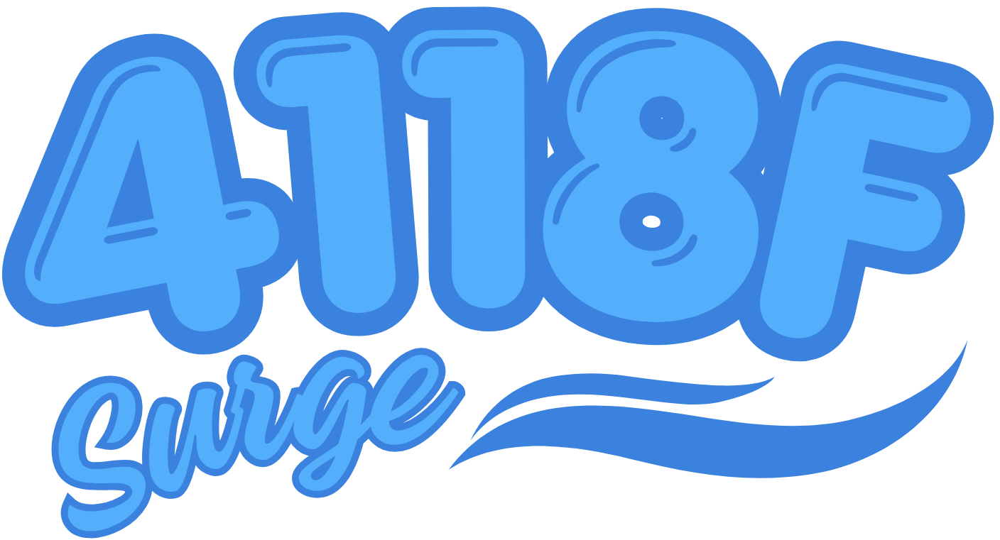

    

This is the main software for 4118F Surge, a competitive robotics team. This program handles the initialization, operator control, and autonomous control of our most recent robot (iteration v1.3, as of writing).

## License
This project is licensed under the MIT license. Check [LICENSE](https://github.com/jasonsimonhtx/4118F_Pinnacle_v1.3/blob/main/LICENSE) for more details.

## Dependencies
| Dependency                                           | Version |
|------------------------------------------------------|---------|
| [PROS](https://github.com/purduesigbots/pros)        | 4.2.3   |
| [LemLib](https://github.com/LemLib/LemLib)           | 0.5.6   |
| [liblvgl](https://github.com/lvgl/lvgl)              | 9.2.0   |
| [fmt](https://github.com/fmtlib/fmt)                 | 12.2.0  |